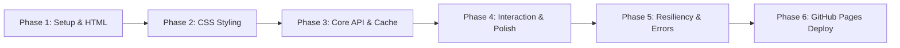

# Repo Roulette - Technical Architecture & Project Plan

## 1. Project Overview & Architecture
**Repo Roulette** is a minimalist, developer-focused client-side web application that introduces developers to popular, active open-source projects via a randomizer ("roulette") mechanism.

### Architecture Overview
- **Type:** Single-Page Static Web Application (SPA architecture without frameworks).
- **Stack:** HTML5, CSS3, Vanilla JavaScript (ES6+).
- **Hosting / Deployment Target:** GitHub Pages (Static hosting).
- **Data Source:** GitHub REST API v3 (Search Repositories endpoint, unauthenticated).
- **Data Flow:**
  1. User selects optional filters (language/topic) and triggers "Spin" / "Randomize".
  2. Application evaluates local cache for active query key.
  3. If cache is empty or exhausted: application queries GitHub Search API, normalizes up to 100 repositories into a local candidate pool.
  4. Local selection engine randomly extracts a non-repeating repository from the pool.
  5. UI renders repository card with smooth micro-interactions.

---

## 2. File Responsibilities

### `index.html`
- **Semantic Structure:** Header/branding, filter toolbar, main repository display card, action controls, and status banners.
- **Accessibility (a11y):** ARIA attributes for live regions (`aria-live="polite"` for dynamic card updates), descriptive labels for inputs/buttons, and semantic elements (`<main>`, `<section>`, `<article>`).
- **No Inline Code:** Exclusively references `styles.css` in the `<head>` and `app.js` via `<script defer>` before `</body>`.

### `styles.css`
- **Design System:** Near-black aesthetic (`#0a0a0a` or `#000000` background, high-contrast monospace and sans-serif typography, subtle borders `#222`, muted text `#888`).
- **Layout & Responsiveness:** Flexbox and Grid layouts optimized for fluid scaling across mobile, tablet, and wide desktop viewports.
- **Micro-Interactions & States:** Minimalist animations (fade-in, subtle card scale, skeleton loader shimmer, button press feedback).
- **Status Styles:** Rate-limit warning banner, loading skeletons, error toasts, and empty state containers.

### `app.js`
- **Application State:** Tracks current filters, active pool of candidate repositories, history of viewed repository IDs, and API quota status.
- **GitHub API Client:** Constructs search queries, handles `fetch` promises, checks HTTP status codes, and reads rate-limit response headers.
- **Candidate Cache Manager:** Stores candidate pools in memory (and `sessionStorage`) keyed by filter combinations to minimize network requests.
- **Selection Engine:** Generates uniform random selection without replacement until the candidate pool is exhausted.
- **DOM Controller:** Efficiently updates DOM elements, toggles loading/disabled button states, and renders formatted numbers (e.g., star count formatting `14.2k`).

---

## 3. GitHub API Query Strategy

### Search Endpoint
`GET https://api.github.com/search/repositories`

### Query Formulation (`q` parameter)
To ensure discovered repositories are both **popular** and **active/recently maintained**:
- **Baseline Popularity:** `stars:>100` (or `stars:>500` depending on language density).
- **Recency Filter:** `pushed:>YYYY-MM-DD` (dynamically calculated to target repositories pushed to within the last 6 to 12 months, avoiding abandoned projects).
- **Language Filter:** `language:{selectedLanguage}` (omitted if "All" is selected).
- **Topic Filter:** `topic:{selectedTopic}` (omitted if blank).

### Example Query String
```text
https://api.github.com/search/repositories?q=stars:>250+pushed:>2026-05-14+language:typescript&sort=stars&order=desc&per_page=100
```
*(Note: Randomizing the `page` parameter between 1 and 5 allows tapping into deeper pools beyond just the top 100).*

---

## 4. Candidate Caching & Random Selection Engine

### Caching Strategy
- **Query Key:** Deterministic hash or string based on active criteria, e.g., `cache_lang:typescript_topic:web`.
- **Storage:** In-memory object during session lifecycle, backed by `sessionStorage` to persist across page refreshes.
- **Pool Sizing:** Request `per_page=100` in a single API call. One request satisfies up to 100 consecutive user spins.

### Selection Without Immediate Repeats
1. Maintain an array `pool` containing repository objects.
2. Maintain a set `viewedIds` containing GitHub repository IDs already displayed.
3. On spin:
   - Filter `pool` against `viewedIds`.
   - If available candidates remain: pick randomly using `Math.floor(Math.random() * pool.length)`.
   - Add chosen repository ID to `viewedIds`.
   - If pool is empty or fully viewed: fetch the next page from GitHub API or recycle viewed pool if all pages are exhausted.

---

## 5. API Limitations & Implementation Risks

| Risk / Limitation | Impact | Mitigation Strategy |
| :--- | :--- | :--- |
| **Search API Rate Limit** | Unauthenticated IP limit is strict: **10 requests/minute** (and 60 requests/hr core). Exceeding causes HTTP 403. | Rely heavily on candidate caching (100 items/fetch). Read `x-ratelimit-remaining` and `x-ratelimit-reset` headers on each response. Disable spin button and show countdown if limit hit. |
| **Niche Filter Zero-Results** | Combining obscure topics and languages may return `total_count: 0`. | Validate response array length. Display friendly "No repositories found matching your criteria" state and offer a one-click filter reset. |
| **Network / API Outages** | API unavailability or browser offline state leads to broken UI. | Wrap fetch calls in robust `try...catch` blocks; render an actionable retry message. |
| **Token Exposure Risk** | Attempting to bypass limits using hardcoded Personal Access Tokens (PAT). | Strictly prohibit any token usage in static client code. Keep code purely unauthenticated. |

---

## 6. Phased Development Sequence



- **Phase 1: Project Setup & Semantic Markup**
  - Create directory structure: `index.html`, `styles.css`, `app.js`.
  - Build semantic HTML markup (header, filter bar, repo card container, spin button, footer).
- **Phase 2: Minimalist Dark UI Styling**
  - Implement CSS variables for monochrome palette (`#000000`, `#111111`, `#222222`, `#EDEDED`, `#888888`).
  - Style responsive typography, repository card layout, and button states.
  - Implement smooth transition utilities and skeleton loading placeholder.
- **Phase 3: GitHub API Integration & Cache Layer**
  - Write query builder supporting language, topic, minimum stars, and recent push dates.
  - Implement candidate caching mechanism (`per_page=100`) and random selection algorithm.
- **Phase 4: DOM Rendering & Interaction Polish**
  - Connect "Spin" button event listeners to selection engine.
  - Render repository details: full name, owner avatar/handle, description, formatted star count, primary language with color indicator, and GitHub link.
  - Add smooth transition animations when swapping repository cards.
- **Phase 5: Edge Cases, Rate Limit & Error Handling**
  - Parse `x-ratelimit-*` headers to display remaining quota / reset timer.
  - Add empty state handling for zero-result queries.
  - Provide offline and network error fallbacks.
- **Phase 6: Verification & Deployment**
  - Audit mobile and desktop responsiveness.
  - Validate accessibility (keyboard navigation, screen reader tags).
  - Initialize Git repository, commit files, push to GitHub, and enable GitHub Pages.

---

## 7. Acceptance Criteria

- [ ] **Core Display:** Successfully displays repository full name (with owner), description, star count, primary language, and an external link opening the repository in a new tab with `rel="noopener noreferrer"`.
- [ ] **Randomization:** Clicking the primary action button displays a random repository from the candidate pool without immediately repeating recent picks.
- [ ] **Filter Controls:** Users can filter by programming language and optionally filter/search by topic.
- [ ] **API Efficiency:** Fetching occurs in batches of up to 100 candidates; multiple spins against the same filter set do not trigger redundant network requests until the pool is exhausted.
- [ ] **Rate Limit & Error Handling:** When rate-limited (HTTP 403), the UI displays a clear message indicating when requests can resume based on the reset timestamp.
- [ ] **Design Requirements:** Follows a near-black, minimalist developer design, clean typography, responsive layout across mobile and desktop, with zero external frontend frameworks or heavy dependencies.
- [ ] **Deployment:** Runs cleanly in any static file server environment or GitHub Pages without build steps.
