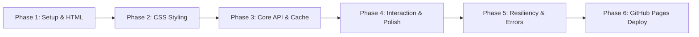

# Repo Roulette - Technical Architecture & Project Plan

## 1. Project Overview & Architecture
**Repo Roulette** is a minimalist, developer-focused client-side web application that introduces developers to popular, active open-source projects via a randomizer ("roulette") mechanism.

### Architecture Overview
- **Type:** Single-Page Static Web Application (SPA architecture without frameworks).
- **Stack:** HTML5, CSS3, Vanilla JavaScript (ES6+).
- **Hosting / Deployment Target:** GitHub Pages (Static hosting).
- **Data Source:** GitHub REST API v3 (Search Repositories endpoint, unauthenticated).
- **Data Flow:**
  1. User configures filter criteria (Minimum Stars, Maximum Stars, and Programming Language) and clicks "Randomize".
  2. Application validates inputs (checking non-negative whole numbers and maximum >= minimum) and compares against active filter configuration in local state.
  3. If filter configuration changed: candidate pool resets to page 1 to fetch fresh results, while session-wide displayed repository IDs are preserved to prevent cross-filter duplicates.
  4. If candidate pool is empty: application queries GitHub Search API using the star range qualifier (`stars:min..max`) and normalizes up to 100 repositories into the candidate pool, filtering out any repository already displayed in the session.
  5. Local selection engine randomly extracts a non-repeating repository from the pool.
  6. UI renders repository card with smooth micro-interactions.

---

## 2. File Responsibilities

### `index.html`
- **Semantic Structure:** Header/branding, filter toolbar (Minimum Stars, Maximum Stars, and Programming Language dropdown), main repository display card, action controls, and status banners.
- **Accessibility (a11y):** ARIA attributes for live regions (`aria-live="polite"` for dynamic card updates), descriptive labels for inputs/buttons, and semantic elements (`<main>`, `<section>`, `<article>`).
- **No Inline Code:** Exclusively references `styles.css` in the `<head>` and `app.js` via `<script defer>` before `</body>`.

### `styles.css`
- **Design System:** Near-black aesthetic (`#0a0a0a` or `#000000` background, high-contrast monospace and sans-serif typography, subtle borders `#222`, muted text `#888`).
- **Layout & Responsiveness:** Flexbox and Grid layouts optimized for fluid scaling across mobile, tablet, and wide desktop viewports (three-column desktop filter layout; single-column stacked mobile layout).
- **Micro-Interactions & States:** Minimalist animations (fade-in, subtle card scale, skeleton loader shimmer, button press feedback).
- **Status Styles:** Rate-limit warning banner, loading skeletons, error toasts, and empty state containers.

### `app.js`
- **Application State:** Tracks applied filters (`minStars`, `maxStars`, `language`), active pool of candidate repositories, session-wide history of viewed repository IDs (`displayedIds`), unvisited pages, pagination, and API quota status.
- **GitHub API Client:** Constructs dynamic search queries with star ranges (`stars:min..max`), recency cutoff, and language qualifiers; handles `fetch` promises, checks HTTP status codes, and reads rate-limit response headers.
- **Filter-Aware Candidate Cache Manager:** Stores candidate pools in `sessionStorage` (`repo_roulette_state_v2`) alongside active filter configurations; invalidates pool upon filter change while preserving global duplicate history; restarts discovery cycle when matching repositories are exhausted.
- **Page Distribution & Selection Engine:** Randomizes page retrieval across accessible pages to prevent descending-star bias; generates uniform random selection without replacement within batches.
- **DOM Controller:** Efficiently updates DOM elements, toggles loading/disabled button states, and renders formatted numbers (e.g., star count formatting `14.2k`).

---

## 3. GitHub API Query Strategy

### Search Endpoint
`GET https://api.github.com/search/repositories`

### Query Formulation (`q` parameter)
To ensure discovered repositories are both **popular** and **active/recently maintained**:
- **Star Range Filter:** Dynamic `stars:min..max` (defaults: `500..100000`; validated as non-negative integers with max >= min).
- **Recency Filter:** Dynamic `pushed:>=YYYY-MM-DD` (calculated for repositories pushed to within the last 12 months, avoiding abandoned projects).
- **Language Filter:** Optional `language:{selectedLanguage}` (qualifiers: `python`, `javascript`, `typescript`, `java`, `cpp`, `rust`, `go`; omitted when "All Languages" is selected).

### Example Query String
```text
https://api.github.com/search/repositories?q=stars:50..100000+pushed:>=2025-11-15+language:python&sort=stars&order=desc&per_page=100&page=1
```

---

## 4. Candidate Caching & Random Selection Engine

### Caching Strategy
- **Filter-Aware Storage:** Applied minimum stars, maximum stars, and programming language are stored alongside the candidate pool, session-wide displayed repository IDs, next page, max page, unvisited pages, and current repository in `sessionStorage` (`repo_roulette_state_v2`).
- **Change Detection & Invalidation:** On Randomize click, current inputs are compared to applied filters. If changed, the old candidate pool is cleared, pagination resets to page 1, new filters are persisted, and the session-wide duplicate history is preserved.
- **Global Duplicate Prevention:** All displayed repository IDs are retained across filter changes. Repositories already in this collection are excluded when parsing new candidate batches.
- **Discovery Cycle Restart:** If every matching repository across all accessible search pages has already been displayed, `displayedIds` is reset to restart the cycle without infinite recursion or excess API requests.
- **Unbiased Page Distribution:** Pages beyond the initial fetch are selected randomly from unvisited accessible pages to eliminate sequential star-descending bias without additional network overhead.
- **Pool Sizing:** Request `per_page=100` in a single API call. One request satisfies up to 100 consecutive user spins.

### Selection Without Immediate Repeats
1. Maintain an array `candidates` containing repository objects.
2. Maintain an array `displayedIds` containing session-wide GitHub repository IDs already displayed.
3. On spin:
   - Pick randomly from `candidates` using `Math.floor(Math.random() * candidates.length)` without replacement (`splice`).
   - Add chosen repository ID to session-wide `displayedIds`.
   - If candidate pool is exhausted: fetch next batch from GitHub API or recycle viewed pool if all accessible search pages are exhausted.

---

## 5. API Limitations & Implementation Risks

| Risk / Limitation | Impact | Mitigation Strategy |
| :--- | :--- | :--- |
| **Search API Rate Limit** | Unauthenticated IP limit is strict: **10 requests/minute** (and 60 requests/hr core). Exceeding causes HTTP 403. | Rely heavily on candidate caching (100 items/fetch). Read `x-ratelimit-remaining` and `x-ratelimit-reset` headers on each response. Disable spin button and show countdown if limit hit. |
| **Niche Filter Zero-Results** | Combining obscure topics and languages may return `total_count: 0`. | Validate response array length. Display friendly "No repositories found matching your criteria" state and offer a one-click filter reset. |
| **Network / API Outages** | API unavailability or browser offline state leads to broken UI. | Wrap fetch calls in robust `try...catch` blocks; render an actionable retry message. |
| **Token Exposure Risk** | Attempting to bypass limits using hardcoded Personal Access Tokens (PAT). | Strictly prohibit any token usage in static client code. Keep code purely unauthenticated. |

---

## 6. Phased Development Sequence



- **Phase 1: Project Setup & Semantic Markup**
  - Create directory structure: `index.html`, `styles.css`, `app.js`.
  - Build semantic HTML markup (header, filter bar, repo card container, spin button, footer).
- **Phase 2: Minimalist Dark UI Styling**
  - Implement CSS variables for monochrome palette (`#000000`, `#111111`, `#222222`, `#EDEDED`, `#888888`).
  - Style responsive typography, repository card layout, and button states.
  - Implement smooth transition utilities and skeleton loading placeholder.
- **Phase 3: GitHub API Integration & Cache Layer**
  - Write query builder supporting language, topic, minimum stars, and recent push dates.
  - Implement candidate caching mechanism (`per_page=100`) and random selection algorithm.
- **Phase 4: DOM Rendering & Interaction Polish**
  - Connect "Spin" button event listeners to selection engine.
  - Render repository details: full name, owner avatar/handle, description, formatted star count, primary language with color indicator, and GitHub link.
  - Add smooth transition animations when swapping repository cards.
- **Phase 5: Edge Cases, Rate Limit & Error Handling**
  - Parse `x-ratelimit-*` headers to display remaining quota / reset timer.
  - Add empty state handling for zero-result queries.
  - Provide offline and network error fallbacks.
- **Phase 6: Verification & Deployment**
  - Audit mobile and desktop responsiveness.
  - Validate accessibility (keyboard navigation, screen reader tags).
  - Initialize Git repository, commit files, push to GitHub, and enable GitHub Pages.

---

## 7. Acceptance Criteria

- [ ] **Core Display:** Successfully displays repository full name (with owner), description, star count, primary language, and an external link opening the repository in a new tab with `rel="noopener noreferrer"`.
- [ ] **Randomization:** Clicking the primary action button displays a random repository from the candidate pool without immediately repeating recent picks.
- [x] **Filter Controls:** Users can filter by star range (Minimum Stars default 500, Maximum Stars default 100000; non-negative whole numbers with max >= min) and programming language (All Languages, Python, JavaScript, TypeScript, Java, C++, Rust, Go), with global duplicate prevention across filter changes.
- [ ] **API Efficiency:** Fetching occurs in batches of up to 100 candidates; multiple spins against the same filter set do not trigger redundant network requests until the pool is exhausted.
- [ ] **Rate Limit & Error Handling:** When rate-limited (HTTP 403), the UI displays a clear message indicating when requests can resume based on the reset timestamp.
- [ ] **Design Requirements:** Follows a near-black, minimalist developer design, clean typography, responsive layout across mobile and desktop, with zero external frontend frameworks or heavy dependencies.
- [ ] **Deployment:** Runs cleanly in any static file server environment or GitHub Pages without build steps.
